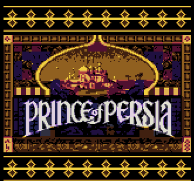
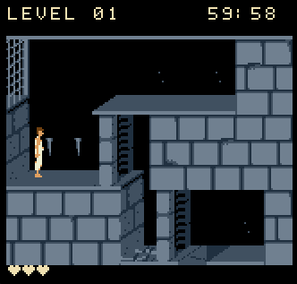

# Prince of Persia — Neo Geo Pocket Color

**An unofficial, AI-assisted adaptation of the original DOS Prince of Persia for the Neo Geo Pocket Color.**

## Gameplay Screenshots

### Title Screen

### Level 1 Gameplay

## Gameplay Video

Watch Prince of Persia running on the Neo Geo Pocket Color!

*Click the image above to watch the gameplay video on YouTube.*

> **Version 1.0.0:** Compiled NGPC ROM prepared for a GitHub Release. Source files and proprietary build tools are not part of this package. The online `PERSIA` leaderboard is subject to activation by its operator. See [Credits & Rights](CREDITS_AND_RIGHTS.md) for copyright and GPL-related distribution considerations.

  

## About the project

This project brings the **14-level DOS Prince of Persia experience** to the Neo Geo Pocket Color. It is based on earlier DOS disassembly / SDLPoP work and has been adapted to run on the NGPC's very limited hardware. The project has been **heavily AI-assisted**; development has also involved repeated human-led testing, feedback, debugging and tuning on a physical console.

Early builds suffered severe slowdowns around doors, chompers, spikes and complex scenery. After extensive rendering, timing and gameplay optimisation the game is now **playable from start to finish on actual hardware**, though **short stutters can still occur in demanding areas**. Trailer footage recorded in emulation generally runs more smoothly than real-hardware play; please do not treat it as a hardware performance benchmark.

### Features

- The original game's **14 levels**, sword combat, traps, puzzles and story sequences.
- Colour NGPC graphics and sound adapted for the handheld.
- **Normal** and **Difficult** difficulty settings.
- Save and continue, level-completion statistics and persistent records.
- A new **points system** for speed, exploration and survival.
- **Best Full Run** and **Best Incomplete Run** records.
- A deliberate **forfeit** option for ending a run without triggering the ending sequence.
- In-game **PERSIA QR-code submission** feature, subject to the online leaderboard being enabled by the site operator.
- An optional hidden level-select / hearts cheat for practice. **Cheat-assisted play is not eligible for records or leaderboard submissions.**

## Playing the game

This ROM targets the **Neo Geo Pocket Color**, including compatible flash cartridges. It can also be loaded in a compatible emulator. Results and performance may differ between emulation and a real console.

### Gameplay controls

| Input | Action |
|---|---|
| D-pad Left / Right | Walk or run in the chosen direction |
| Up | Vertical / standing jump |
| A | Forward jump; hold Left/Right + A for a running jump |
| Hold B | Careful movement / grab ledges |
| Down + B | Careful downward interaction / pick-up |
| During sword combat: A | Attack |
| During sword combat: B or Up | Parry |
| Option | Pause / resume |

A practical tip: **Up** is the standing vertical jump; **A** is the forward-running jump action. For the full button guide, see [CONTROLS_AND_CHEATS.md](CONTROLS_AND_CHEATS.md).

### Main menu and saving

| Input | Action |
|---|---|
| A | Start a new game (confirmation appears if a save exists) |
| Tap and release B | Toggle Normal / Difficult |
| Option | Continue a saved game, when available |
| B + Up | Open Records, when eligible and accessible |
| B + Down | Controls page |
| B + Left | Reset confirmation — **deletes the save and records** if confirmed |

**Normal:** Begins with three health hearts and no fixed campaign-attempt limit. **Difficult:** Begins with two health hearts and a fixed total of three attempts (initial attempt plus two retries). The hidden hearts setting is separate from that retry limit.

While **paused**: Option resumes; A restarts the level; a short B press saves and returns to title; B + Up opens Records (when available); **B + Down** opens a **forfeit confirmation**. Save/continue is not a mid-frame save state — level/checkpoint progress is retained according to the game's save system.

## Scoring

The game awards points for a **completed level**, based on the time taken and that level's own time target. Faster completion means more time points. Bonuses and penalties then adjust the level total:

| Event | Points |
|---|---:|
| Small potion collected | **+50** |
| Large potion collected | **+200** |
| Sword hit received | **−25** |
| Death | **−100** |
| Level completion time | Varies by time taken and the individual level's target |

**Total Level Points** = time points + potion bonuses − sword-hit penalties − death penalties, never below zero. **Run Total** adds the awarded points from completed levels, up to 10,000. Failed-attempt potion bonuses are not repeatedly farmable by retrying.

The completion screen shows **Time Taken**, **Time Points**, potion and sword/death adjustments, **Total Level Points**, and **Run Total**. The per-level target system is detailed in [SCORING_AND_LEADERBOARDS.md](SCORING_AND_LEADERBOARDS.md).

## Records, forfeits and QR leaderboard

- **Current Run:** Ongoing eligible run statistics.
- **Best Full Run:** Your highest-scoring completed 14-level run (time is used to break a score tie).
- **Best Incomplete Run:** Your highest-scoring legitimately **forfeited** run, kept separately from Best Full Run.
- **One scoring system / one intended leaderboard:** Both completed and forfeited results use the same points calculation, not separate leaderboards. Unfinished levels do **not** grant completion points.

Use **Left/Right** to navigate records pages and **Up/Down** to change the available record view. The sixth page of Best Full Run or Best Incomplete Run offers QR submission. After a legitimate full ending, or after a confirmed forfeit, the game can also show the initials-entry / QR flow.

To prepare a submission, enter **three initials** (Up/Down to change letters; Left/Right to move) and press **Option** to generate a phone-scannable QR code. Scan it with your phone to open **[ngpc-dev.com](https://www.ngpc-dev.com/)**. Website acceptance and login/confirmation depend on the leaderboard site and its `PERSIA` integration; **a code appearing on screen does not guarantee online submission is live**. The developer must support completed and forfeited payloads on the same ranking.

**Cheat mode excludes scores from recording/submission.** This is intentional, even if you use the level cheat to finish Level 14. See [SCORING_AND_LEADERBOARDS.md](SCORING_AND_LEADERBOARDS.md).

## Hidden cheat — practice mode (spoilers)

Reveal level-select and health cheat

From the **title screen**, rotate the D-pad **clockwise 10 complete turns** through the eight directional positions (Up → Up-Right → Right → Down-Right → Down → Down-Left → Left → Up-Left → Up, repeating). Once recognised:

- **Left / Right** chooses a starting level from **1–14**.
- **Up / Down** adjusts starting **health hearts**, from the difficulty's minimum (Normal 3, Difficult 2) up to **10**.
- Press **A** to begin with those choices.

This changes health hearts, **not** the fixed retry-attempt allowance in Difficult mode.

**Important:** Unlocking the cheat disables eligible record / online leaderboard submission for cheat-assisted play. Completing the final level via level select will not award a legitimate Best Full Run. The reset-data option clears the cheat, **but also erases saved progress and records**. Always read the reset confirmation.

## Known limitations

- **Real-hardware stutters:** Some hazard-heavy rooms can briefly slow Prince down, particularly where multiple animated objects, actors and foreground graphics overlap. The game has been played through on hardware, but it is not guaranteed to be completely free of stutter.
- **Emulator footage:** Trailers use emulation and may appear smoother than original hardware. No intentional artificial speed-up is claimed for those clips.
- **Online leaderboard:** `PERSIA` is a proposed game code. The QR payload is implemented in the game, but server-side registration, parser acceptance and real-console phone scanning require separate verification with [ngpc-dev.com](https://www.ngpc-dev.com/).
- **Original-game content and licences:** This unofficial port contains third-party game content and GPL-derived code. ROM-only distribution may not satisfy copyright permissions or GPL source-availability requirements. See [CREDITS_AND_RIGHTS.md](CREDITS_AND_RIGHTS.md).

For technical and rights notices, see [CREDITS_AND_RIGHTS.md](CREDITS_AND_RIGHTS.md).

## Downloads and releases

The compiled ROM is **`Prince_of_Persia-NGPC-v1.0.0.ngc`** (2,097,152 bytes / 2 MiB). It is included in this prepared package under `GitHub_Release_ROM/` and is intended to be attached to a GitHub **Release** rather than committed into repository history. The exact SHA-256 checksum is in [ROM_CHECKSUM_SHA256.txt](ROM_CHECKSUM_SHA256.txt).

**The game source code and Toshiba toolchain are not included.** See [CREDITS_AND_RIGHTS.md](CREDITS_AND_RIGHTS.md) for the unresolved source-licence and copyright implications of publishing a binary-only release.

## Credits and thanks

- **Jordan Mechner** — creator of the original *Prince of Persia*.
- **[SDLPoP](https://github.com/NagyD/SDLPoP)**, created by **Dávid Nagy (NagyD)**, and the DOS disassembly / reverse-engineering contributors — an essential foundation for this port.
- **[ngpc-dev.com](https://www.ngpc-dev.com/)** and its NGPC leaderboard work — a major motivation for the scoring and QR submission features.
- The NGPC homebrew and testing community.

This project is unofficial, non-commercial in intent, and not endorsed by the original rights holders, the SDLPoP contributors, SNK or the leaderboard site's operator. Free distribution does not remove copyright or open-source licence obligations.

**Project status:** v1.0.0 ROM prepared for release; real-hardware stutters remain, online leaderboard activation is pending, and redistribution rights/source obligations have not been established.
